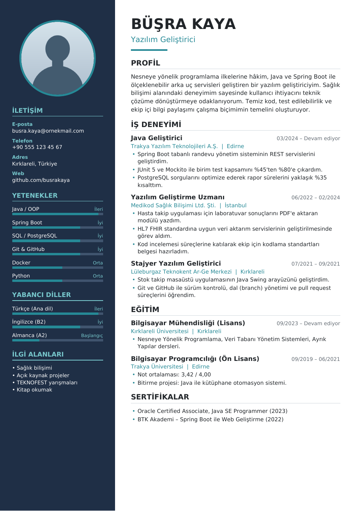

# Java PDF Özgeçmiş Oluşturucu

Nesneye Yönelik Programlama (NYP) dersi kapsamında geliştirilmiş, Java ile **fotoğraflı, A4 boyutunda PDF özgeçmiş** üreten bir konsol uygulamasıdır. PDF üretimi için [Apache PDFBox](https://pdfbox.apache.org/) kütüphanesi kullanılmıştır.

<p align="center">
  
</p>

Örnek çıktı: [`docs/ornek-ozgecmis.pdf`](docs/ornek-ozgecmis.pdf)

> Özgeçmişteki kişisel bilgiler ve üç iş deneyimi **hayalidir**.

---

## İçindekiler

- [Özellikler](#özellikler)
- [Gereksinimler](#gereksinimler)
- [Kurulum ve Çalıştırma](#kurulum-ve-çalıştırma)
- [Proje Yapısı](#proje-yapısı)
- [Sınıf Diyagramı](#sınıf-diyagramı)
- [Kullanılan Bileşenler ve Nesneler](#kullanılan-bileşenler-ve-nesneler)
- [Uygulanan NYP İlkeleri](#uygulanan-nyp-i̇lkeleri)
- [Nesne Yaşam Döngüsü](#nesne-yaşam-döngüsü)
- [Erişim Belirleyiciler](#erişim-belirleyiciler)
- [Kendi Özgeçmişinizi Oluşturma](#kendi-özgeçmişinizi-oluşturma)
- [Yapay Zekâ Aracının Kullanımı](#yapay-zekâ-aracının-kullanımı)
- [Lisans](#lisans)

---

## Özellikler

- A4 boyutunda, iki sütunlu (kenar çubuğu + ana içerik) modern tasarım
- Daire şeklinde kırpılmış profil fotoğrafı
- İletişim, profil özeti, iş deneyimi, eğitim, yetenekler, yabancı diller, sertifikalar ve ilgi alanları bölümleri
- Yetenek ve dil seviyeleri için ilerleme çubukları
- Türkçe karakter desteği (ç, ğ, ı, İ, ö, ş, ü) — DejaVu Sans fontu PDF'e gömülür
- Uzun metinlerin otomatik satır kaydırması ve içerik sığmadığında otomatik yeni sayfa
- PDF belge özellikleri (başlık, yazar, oluşturma tarihi) otomatik doldurulur
- PDF üretimi `main` metodunda değil, ayrı bir sınıfta (`OzgecmisPdfOlusturucu`) yapılır
- Grafik arayüz gerektirmez; komut satırından çalışır

## Gereksinimler

| Araç | Sürüm |
|------|-------|
| JDK  | 17 veya üzeri |
| Maven | 3.8 veya üzeri (IntelliJ içinde hazır gelir) |
| IDE | IntelliJ IDEA (önerilen) |

## Kurulum ve Çalıştırma

### IntelliJ IDEA ile (önerilen)

1. Depoyu klonlayın veya **File → New → Project from Version Control** ile açın:
   ```bash
   git clone https://github.com/<kullanici-adi>/ozgecmisim.git
   ```
2. IntelliJ projeyi **Maven projesi** olarak tanır ve PDFBox bağımlılığını otomatik indirir.
3. `src/main/java/org/ozgecmis/Main.java` dosyasını açıp `main` metodunun yanındaki **▶ Run** düğmesine basın.
4. PDF, proje kök dizininde `cikti/ozgecmis.pdf` olarak oluşturulur.

### Komut satırından (Maven)

```bash
mvn compile exec:java -Dexec.mainClass=org.ozgecmis.Main
```

## Proje Yapısı

```
ozgecmisim/
├── pom.xml                              # Maven yapılandırması ve bağımlılıklar
├── docs/
│   ├── ornek-ozgecmis.pdf               # Uygulamanın ürettiği örnek çıktı
│   └── onizleme.png                     # README önizleme görseli
└── src/main/
    ├── java/org/ozgecmis/
    │   ├── Main.java                    # Giriş noktası: nesneleri oluşturur ve bağlar
    │   ├── model/                       # Veri (model) sınıfları
    │   │   ├── Ozgecmis.java            # Tüm bölümleri tutan ana model + Builder
    │   │   ├── Kisi.java                # Ad, soyad, unvan, fotoğraf
    │   │   ├── IletisimBilgisi.java     # E-posta, telefon, adres, web (immutable)
    │   │   ├── ZamanAralikliKayit.java  # Soyut temel sınıf (tarih aralıklı kayıtlar)
    │   │   ├── IsDeneyimi.java          # ZamanAralikliKayit alt sınıfı
    │   │   ├── Egitim.java              # ZamanAralikliKayit alt sınıfı
    │   │   └── Yetenek.java             # Yetenek/dil + iç içe Seviye enum'u
    │   ├── pdf/
    │   │   ├── BelgeOlusturucu.java     # Arayüz (interface)
    │   │   └── OzgecmisPdfOlusturucu.java # PDF'i çizen sınıf (PDFBox)
    │   └── veri/
    │       └── OrnekVeri.java           # Hayali örnek özgeçmiş verisi
    └── resources/
        ├── fonts/                       # DejaVu Sans (Türkçe karakter desteği)
        └── images/profil.png            # Profil fotoğrafı
```

Paketler sorumluluğa göre ayrılmıştır: **model** veriyi, **pdf** sunumu (çıktı üretimini), **veri** örnek içeriği barındırır. Böylece örneğin PDF tasarımı değiştiğinde model sınıflarına dokunmak gerekmez.

## Sınıf Diyagramı

```mermaid
classDiagram
    direction LR

    class BelgeOlusturucu {
        <<interface>>
        +olustur(Ozgecmis, Path) void
    }
    class OzgecmisPdfOlusturucu {
        -PDDocument belge
        -PDPageContentStream akis
        -float imlecY
        -int olusturulanBelgeSayisi$
        +olustur(Ozgecmis, Path) void
        -kenarCubugunuCiz(Ozgecmis) void
        -anaIcerigiYaz(Ozgecmis) void
        -kayitYaz(ZamanAralikliKayit) void
    }
    class Ozgecmis {
        -Kisi kisi
        -String profilOzeti
        -List~IsDeneyimi~ deneyimler
        -List~Egitim~ egitimler
        -List~Yetenek~ yetenekler
        +builder()$ Builder
    }
    class Builder {
        +kisi(Kisi) Builder
        +deneyimEkle(IsDeneyimi) Builder
        +build() Ozgecmis
    }
    class Kisi {
        -String ad
        -String soyad
        -String fotografYolu
        +getTamAd() String
    }
    class IletisimBilgisi
    class ZamanAralikliKayit {
        <<abstract>>
        #String baslik
        #String kurum
        #YearMonth baslangic
        #YearMonth bitis
        +getTarihAraligi() String
        +getAciklamaMaddeleri()* List~String~
    }
    class IsDeneyimi
    class Egitim
    class Yetenek
    class Seviye {
        <<enumeration>>
        BASLANGIC
        ORTA
        IYI
        ILERI
    }

    BelgeOlusturucu <|.. OzgecmisPdfOlusturucu
    OzgecmisPdfOlusturucu ..> Ozgecmis : kullanır
    Ozgecmis +-- Builder
    Ozgecmis *-- Kisi
    Kisi *-- IletisimBilgisi
    Ozgecmis o-- IsDeneyimi
    Ozgecmis o-- Egitim
    Ozgecmis o-- Yetenek
    ZamanAralikliKayit <|-- IsDeneyimi
    ZamanAralikliKayit <|-- Egitim
    Yetenek +-- Seviye
```

## Kullanılan Bileşenler ve Nesneler

### Proje sınıfları

| Sınıf / Tür | Türü | Görevi | Neden bu şekilde tasarlandı? |
|---|---|---|---|
| `Main` | Sınıf | Uygulamayı başlatır, nesneleri oluşturur ve birbirine bağlar | Ödev gereği PDF işlemi `main` içinde yapılmaz; `main` yalnızca koordinasyon görevi görür |
| `BelgeOlusturucu` | Arayüz | `olustur(Ozgecmis, Path)` sözleşmesini tanımlar | `Main` somut sınıfa değil arayüze bağımlıdır; ileride HTML/DOCX çıktısı eklemek kolaylaşır |
| `OzgecmisPdfOlusturucu` | Sınıf | PDFBox ile sayfayı, fotoğrafı, metinleri ve çubukları çizer | Sunum mantığını tek bir sınıfta toplar (tek sorumluluk ilkesi) |
| `Ozgecmis` | Sınıf (`final`) | Özgeçmişin tüm bölümlerini bir arada tutar | Çok sayıda alan olduğu için **Builder** deseniyle okunabilir şekilde oluşturulur |
| `Ozgecmis.Builder` | Static iç sınıf | `Ozgecmis` nesnesini adım adım kurar | Uzun parametreli kurucu yerine zincirleme (fluent) çağrılar sağlar |
| `Kisi` | Sınıf | Ad, soyad, unvan, fotoğraf yolu ve iletişim bilgisi | Kimlik bilgilerini tek nesnede toplar; `IletisimBilgisi` ile kompozisyon kurar |
| `IletisimBilgisi` | Sınıf (`final`) | E-posta, telefon, adres, web | Değişmez (immutable) nesne; oluşturulduktan sonra değiştirilemez |
| `ZamanAralikliKayit` | Soyut sınıf | Başlık, kurum, konum, başlangıç-bitiş tarihi | `IsDeneyimi` ve `Egitim`'in ortak alanlarını tekrar yazmamak için (kalıtım) |
| `IsDeneyimi` | Alt sınıf | Pozisyon ve sorumluluk maddeleri | `getAciklamaMaddeleri()` metodunu kendine göre uygular |
| `Egitim` | Alt sınıf | Bölüm, okul, not ortalaması, açıklama | `getAciklamaMaddeleri()` metodunu kendine göre uygular |
| `Yetenek` | Sınıf | Yetenek/dil adı ve seviyesi | Aynı yapı hem yetenekler hem diller için yeniden kullanılır |
| `Yetenek.Seviye` | Enum | BASLANGIC, ORTA, IYI, ILERI | Seviyeler sabit bir kümedir; her sabit etiket ve çubuk doluluk oranı taşır |
| `OrnekVeri` | Yardımcı sınıf (`final`) | Hayali özgeçmiş verisini üretir | Veri ile çizim kodunu birbirinden ayırır; `private` kurucu ile örneklenmesi engellenmiştir |

### Kütüphane ve Java standart nesneleri

| Nesne | Kaynak | Kullanım amacı |
|---|---|---|
| `PDDocument` | PDFBox | Bellekteki PDF belgesinin kendisi; sayfaları ve kaynakları tutar. `AutoCloseable` olduğundan try-with-resources ile kapatılır |
| `PDPage`, `PDRectangle.A4` | PDFBox | A4 boyutunda (595 × 842 pt) sayfa |
| `PDPageContentStream` | PDFBox | Sayfaya metin, dikdörtgen, daire ve resim çizen "kalem" nesnesi |
| `PDType0Font` | PDFBox | TrueType fontu PDF'e gömer; Türkçe karakterler için gereklidir (standart Helvetica fontunda ş, ğ, ı yoktur) |
| `PDImageXObject` | PDFBox | Profil fotoğrafını PDF'e yerleştirir |
| `PDDocumentInformation` | PDFBox | PDF'in başlık, yazar ve tarih bilgileri |
| `java.awt.Color` | Java SE | Tasarım renkleri |
| `YearMonth`, `DateTimeFormatter` | `java.time` | Ay/yıl hassasiyetinde tarih ve "MM/yyyy" biçimlendirmesi |
| `Path`, `Files` | `java.nio.file` | Çıktı yolunu oluşturma, klasör açma, fotoğraf okuma |
| `List.copyOf`, `ArrayList` | `java.util` | Değiştirilemez liste kopyaları ve Builder içindeki geçici listeler |
| `Objects.requireNonNull` | `java.util` | Zorunlu alanların `null` olmasını kurucu metotta engeller |

## Uygulanan NYP İlkeleri

**Kapsülleme (Encapsulation):** Tüm alanlar `private` (veya alt sınıflar için `protected`) tanımlanmış, dışarıya yalnızca getter metotları açılmıştır. Listeler `List.copyOf` ile kopyalanarak döndürüldüğü için dışarıdan `getDeneyimler().add(...)` gibi bir değişiklik yapılamaz.

**Kalıtım (Inheritance):** `IsDeneyimi` ve `Egitim` sınıfları `ZamanAralikliKayit` soyut sınıfından türetilmiştir. Tarih aralığı biçimlendirme (`getTarihAraligi()`) ve tarih doğrulaması tek bir yerde yazılmıştır.

**Çok Biçimlilik (Polymorphism):** `OzgecmisPdfOlusturucu.kayitYaz(ZamanAralikliKayit kayit)` metodu hem iş deneyimlerini hem eğitimleri aynı kodla çizer. Çağrılan `getAciklamaMaddeleri()` metodunun hangi sürümünün çalışacağına çalışma zamanında nesnenin gerçek tipine bakılarak karar verilir.

**Soyutlama (Abstraction):** `BelgeOlusturucu` arayüzü "özgeçmişten belge üret" işini tanımlar ama nasıl yapılacağını söylemez. `Main` sınıfında değişkenin tipi arayüzdür:

```java
BelgeOlusturucu olusturucu = new OzgecmisPdfOlusturucu();
olusturucu.olustur(ozgecmis, ciktiYolu);
```

**Kompozisyon (Composition):** `Ozgecmis` bir `Kisi` içerir, `Kisi` de bir `IletisimBilgisi` içerir ("has-a" ilişkisi).

**Tasarım deseni — Builder:** `Ozgecmis` nesnesi `private` kurucu metot ve iç `Builder` sınıfı ile oluşturulur. Bu sayede alanların sırasını ezberlemeye gerek kalmaz ve oluşan nesne değişmez olur.

## Nesne Yaşam Döngüsü

Uygulama çalıştığında nesneler aşağıdaki sırayla oluşturulur, kullanılır ve yok edilir:

1. **Sınıf yükleme:** JVM `Main` sınıfını yükler. `static final` sabitler (renkler, sayfa ölçüleri) ve `static` sayaç (`olusturulanBelgeSayisi`) sınıf ilk kullanıldığında bir kez oluşturulur ve program sonuna kadar yaşar.
2. **Model nesnelerinin oluşturulması:** `OrnekVeri.ozgecmisOlustur()` içinde `new IletisimBilgisi(...)`, `new Kisi(...)`, `new IsDeneyimi(...)` vb. ile nesneler **heap** belleğinde oluşturulur. Kurucu metotlar (`constructor`) zorunlu alanları `Objects.requireNonNull` ile doğrular; geçersiz veriyle (ör. bitiş tarihi başlangıçtan önce) nesne hiç oluşmaz, `IllegalArgumentException` fırlatılır.
3. **Builder'ın kısa ömrü:** `Ozgecmis.builder()` bir `Builder` nesnesi oluşturur. `build()` çağrıldıktan sonra Builder'a hiçbir referans kalmaz ve çöp toplayıcı (Garbage Collector) tarafından toplanabilir hâle gelir.
4. **Kaynak yönetimi (try-with-resources):** `OzgecmisPdfOlusturucu.olustur()` içinde `PDDocument` şu şekilde açılır:

   ```java
   try (PDDocument yeniBelge = new PDDocument()) {
       ...
       yeniBelge.save(ciktiYolu.toFile());
   } // burada close() otomatik çağrılır
   ```

   `PDDocument` `AutoCloseable` arayüzünü uyguladığı için blok bittiğinde — hata oluşsa bile — `close()` otomatik çağrılır ve dosya/bellek kaynakları serbest bırakılır. Font ve fotoğraf okumak için açılan `InputStream`'ler de aynı yöntemle kapatılır.
5. **Sayfa başına nesneler:** Her yeni sayfa için yeni bir `PDPage` ve `PDPageContentStream` oluşturulur. Yeni sayfaya geçmeden önce eski akış `akisiKapat()` ile kapatılır; kapatılmayan bir akış PDF'in bozuk kaydedilmesine yol açar.
6. **Temizlik:** `finally` bloğunda `belge`, `normalFont`, `kalinFont` alanları `null` yapılır. Böylece kapatılmış nesnelere referans tutulmaz ve GC bu nesneleri toplayabilir.
7. **Program sonu:** `main` metodu bittiğinde yerel değişkenler (`ozgecmis`, `olusturucu`) kapsam dışına çıkar; JVM kapanırken tüm bellek serbest bırakılır.

```
new Kisi(...) ──► kurucu metot doğrular ──► nesne kullanılır ──► referans kalmaz ──► GC toplar
new PDDocument() ──► try bloğunda kullanılır ──► close() (otomatik) ──► GC toplar
```

## Erişim Belirleyiciler

| Belirleyici | Projede nerede kullanıldı? | Neden? |
|---|---|---|
| `public` | Tüm sınıflar, getter metotları, `BelgeOlusturucu.olustur()`, `Ozgecmis.builder()` | Diğer paketlerden erişilmesi gereken arayüz |
| `private` | Tüm model alanları, `OzgecmisPdfOlusturucu`'nun yardımcı çizim metotları (`metinYaz`, `satirlaraBol`, `dairePathOlustur` …), `Ozgecmis` ve `OrnekVeri` kurucu metotları | İç ayrıntıları gizlemek (kapsülleme); `Ozgecmis` yalnızca Builder ile, `OrnekVeri` hiç örneklenemesin diye |
| `protected` | `ZamanAralikliKayit` alanları (`baslik`, `kurum`, `baslangic`, `bitis`) ve kurucu metodu | Yalnızca alt sınıfların (`IsDeneyimi`, `Egitim`) erişebilmesi için |
| *(paket-özel / default)* | Kullanılmadı | Paketler arası erişim gerektiği için tüm sınıflar bilinçli olarak `public` tutuldu |

Ek olarak kullanılan belirleyiciler:

- **`final` sınıf** (`Ozgecmis`, `IletisimBilgisi`, `OrnekVeri`): kalıtımla değiştirilmesi istenmeyen sınıflar.
- **`final` alan**: bir kez atanıp değişmeyen değerler (nesnelerin değişmezliği).
- **`static`**: nesneye değil sınıfa ait olan üyeler — sabitler, `olusturulanBelgeSayisi` sayacı, `OrnekVeri.ozgecmisOlustur()` ve `Ozgecmis.builder()` fabrika metotları.
- **`abstract`**: `ZamanAralikliKayit` sınıfı ve `getAciklamaMaddeleri()` metodu; alt sınıfları bu metodu uygulamaya zorlar.

## Kendi Özgeçmişinizi Oluşturma

1. `src/main/java/org/ozgecmis/veri/OrnekVeri.java` dosyasındaki ad, iletişim, deneyim, eğitim ve yetenek bilgilerini değiştirin.
2. Kendi fotoğrafınızı `src/main/resources/images/profil.png` olarak kaydedin **veya** `Kisi` nesnesine bilgisayarınızdaki dosya yolunu verin (ör. `"C:/Users/ben/foto.jpg"`). PNG ve JPG desteklenir; kare olmayan fotoğraflar otomatik olarak ortalanıp daireye kırpılır.
3. `Main` sınıfını yeniden çalıştırın.

## Yapay Zekâ Aracının Kullanımı

Bu projenin geliştirilmesinde yapay zekâ destekli asistan olarak **Claude (Anthropic)** kullanılmıştır. Proje IntelliJ IDEA üzerinde, asistanın yönlendirmesiyle adım adım oluşturulmuştur:

- Maven projesinin kurulması ve PDFBox bağımlılığının `pom.xml` dosyasına eklenmesi
- Paket yapısının ve sınıflar arası ilişkilerin (arayüz, soyut sınıf, kalıtım, Builder deseni) planlanması
- Sınıfların kodlarının oluşturulması ve her sınıfta kullanılan NYP kavramlarının açıklanması
- Türkçe karakter sorununun (standart PDF fontlarında ş, ğ, ı bulunmaması) TrueType font gömülerek çözülmesi
- Kurulum sırasında karşılaşılan hataların (macOS'te Git/Xcode lisansı, sınıf adı–dosya adı uyumsuzluğu) giderilmesi
- README dokümantasyonunun hazırlanması

Kodlar tarafımdan IntelliJ'de oluşturulmuş, çalıştırılmış, çıktısı kontrol edilmiş ve ders kapsamındaki kavramlarla (nesne yaşam döngüsü, erişim belirleyiciler, kalıtım, çok biçimlilik) ilişkilendirilmiştir.

## Lisans

Kaynak kodu eğitim amaçlıdır ve [MIT Lisansı](https://opensource.org/licenses/MIT) ile serbestçe kullanılabilir.

Kullanılan üçüncü taraf bileşenler:

- [Apache PDFBox](https://pdfbox.apache.org/) — Apache License 2.0
- [DejaVu Fonts](https://dejavu-fonts.github.io/) — Bitstream Vera / DejaVu ücretsiz font lisansı
